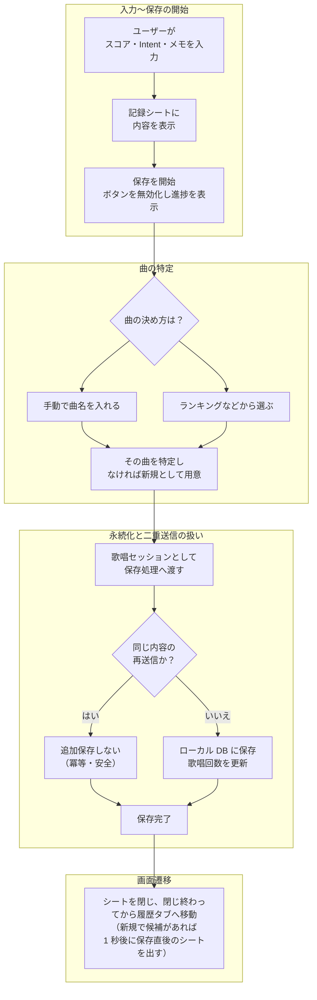
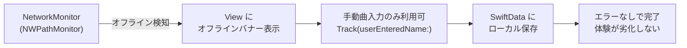
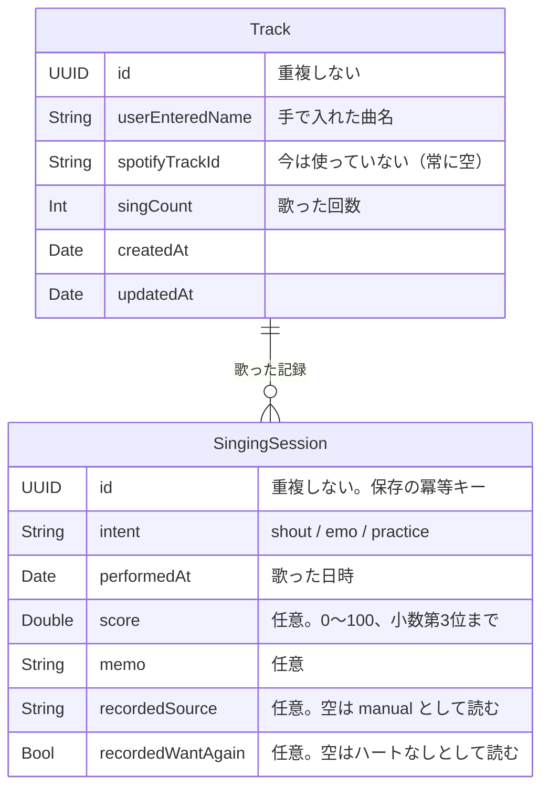
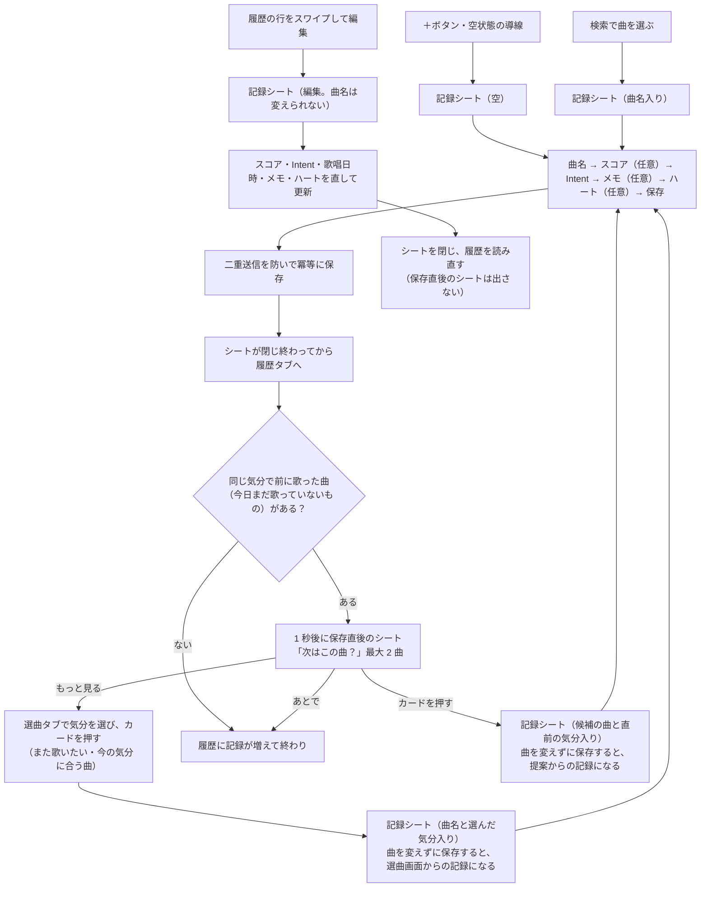

# アーキテクチャ

## 採用設計: MVVM + Repository パターン

| レイヤー | 責務 | SwiftUI 依存 |
|----------|------|--------------|
| **Presentation** | View（描画専用）+ ViewModel（`@Observable`・`@MainActor`） | Yes |
| **Domain** | Protocol 定義・Model 定義・ヘルパー。外部 FW 非依存が原則 | No（※ @Model のみ例外許容） |
| **Data** | SwiftData / Network の具体実装 | No |
| **App** | `@main` エントリ、DI 組み立て、EnvironmentKey 定義 | Yes |

---

## 技術選定の理由

### SwiftData（ローカル永続化）

Track と SingingSession の **リレーション・クエリ** が前提のため、永続化手段を次のように比較し **SwiftData** を採用した。

| 候補 | 特徴・制約 | 本プロジェクトでの判断 |
|------|------------|------------------------|
| **UserDefaults** | キー・バリュー向け。リレーション・クエリに不向き。 | 不採用 |
| **FileManager** | 生ファイル運用。整合性・検索・リレーションを自前で担保する必要あり。 | 不採用 |
| **Core Data** | 表現力は十分。スタック構成・マイグレーションの手間が大きい。 | 今回は見送り |
| **SwiftData** | `@Model` で Swift ネイティブに近い形でスキーマを定義でき、導入・変更のしやすさも両立。 | **採用** |

### `@Observable`（iOS 17+・ViewModel の状態管理）

| 観点 | `ObservableObject` + `@Published` | `@Observable` |
|------|-------------------------------------|----------------|
| 変更通知 | `@Published` や `objectWillChange` の記述が増えやすい | マクロが **プロパティ変更を観測** |
| View との接続 | `@StateObject` / `@ObservedObject` | `@State` / `@Bindable` で保持・バインドしやすい |
| ViewModel の書き方 | `ObservableObject` 準拠が前提 | **通常のクラス**として記述しやすい |

**採用理由**: ボイラープレート削減と、View 側の所有の説明の単純化を優先。

### その他（Repository・手動 DI）

| 技術 | 選定理由 |
|------|----------|
| **Repository パターン** | SSOT をローカル DB に限定し、オフラインファーストを実現。Protocol 分離でテスト時に in-memory / mock に差し替え |
| **手動 DI（`@Environment`）** | V1 は依存グラフが浅く、Swinject 等のコンテナは過剰。SwiftUI の `Environment` でプロトコル型を渡す方式で、プレビュー・テストでの差し替えもそのまま行える |

---

## データフロー

### 歌唱記録の保存フロー

オンライン・オフライン問わず同じ流れ。View → ViewModel → Repository → SwiftData の各層が明確に分離されている:

### オフライン時の挙動

---

## 技術的な設計

### 状態管理

| 仕組み | 用途 |
|--------|------|
| `@Observable` + `@MainActor` | ViewModel の状態保持。1 画面 1 ViewModel |
| `@State` | View 内の一時 UI 状態、ViewModel インスタンスの保持 |
| `@Binding` | 親→子の双方向バインディング |
| `@Environment` | Repository・NetworkMonitor 等のアプリ全体共有 |

### 非同期処理

- **`async throws`** を基本とする構造化並行性（Swift Concurrency）
- Repository・ViewModel とも `@MainActor` で ModelContext のスレッド安全性を保証
- `Task.checkCancellation()` によるキャンセル伝播 + `loadGeneration` による世代管理

### オフラインファースト

- `NWPathMonitor` ベースの `NetworkMonitor`（`@Observable`）で接続状態を監視
- オフライン時: `Track(userEnteredName:)` でローカル保存。ブロックせず継続

---

## データベース（SwiftData）

記録はすべて端末の中の SwiftData に保存し、これを唯一の正（SSOT）とする。外部のサーバーには送らない。

### 保存先と開き方

- 保存先は端末の中の 1 つのファイル（Application Support の `default.store`。中身は SQLite）
- 起動時に `AppDependencies.make(configuration:)` が `ModelContainer` を 1 つ作り、全部の Repository が同じ `mainContext` を使う。`ModelContext` はスレッドセーフではないので、Repository は `@MainActor` で動く
- 保存先を開けなかったときは、メモリ上の DB で起動せず、エラー画面で止める。元のデータには手を付けない（[ADR 0033](adr/0033-show-error-when-store-cannot-open.md)）
- ユニットテストと UI テストは、メモリ上の DB（`isStoredInMemoryOnly: true`）を使う

### モデル

| モデル | 項目 | 説明 |
|---|---|---|
| `Track`（曲） | `id` | 重複しない UUID |
| | `userEnteredName` | 手で入れた曲名。曲名が完全に同じなら同じ曲として使い回す |
| | `spotifyTrackId` | 列はあるが、今は画面から入ることがなく常に空 |
| | `singCount` | 歌った回数。記録を足すと 1 増え、消すと 1 減る |
| | `sessions` | この曲の記録。曲を消すと記録も消える（cascade）が、今のアプリは曲を消さない |
| `SingingSession`（記録） | `id` | 重複しない UUID。同じ `id` の保存は 1 回だけ反映する（冪等キー） |
| | `track` | 歌った曲（1 つの曲に、記録がいくつもつく） |
| | `intent` | 気分。enum を文字列で保存する |
| | `performedAt` | 歌った日時。新規では保存した時刻（[ADR 0015](adr/0015-performed-at-from-save-time.md)） |
| | `score` | 点数。任意で、0〜100 の小数第 3 位まで（[ADR 0012](adr/0012-score-three-decimals-optional.md)） |
| | `memo` | メモ。任意 |
| | `recordedSource` | どこから付けた記録か（保存直後の提案から／選曲画面から／それ以外）。空を許し、空（入口を記録し始める前の記録）は `manual` として読む（[ADR 0034](adr/0034-record-source-as-optional-enum.md)） |
| | `recordedWantAgain` | また歌いたいか（ハート）。空を許し、空（ハートを付けられるようになる前の記録）はハートなしとして読む。編集で変えられる |

### 書き込みの決まり

書き込みは必ず Repository を通す。View から `ModelContext` に直接書かない。

| 操作 | やること |
|---|---|
| 新規の保存 | 同じ `id` の記録がなければ足し、曲の `singCount` を 1 増やす。同じ `id` の再送は何もせず成功にする（[ADR 0006](adr/0006-idempotent-save-in-ui-and-data.md)） |
| 編集して更新 | 気分・日時・点数・メモ・ハートだけを書き換える。曲と入口は変えない |
| 削除 | 記録を消し、曲の `singCount` を 1 減らす（0 より下にはしない） |
| 曲の用意 | 曲名が完全に同じ曲があればそれを使い、なければ新しく作る |

### 読み方

| 用途 | 読み方 |
|---|---|
| 履歴 | 日時の新しい順に 20 件ずつ読み、最大 500 件まで出す |
| 気分での絞り込み | `#Predicate` で enum を使わず、直近 200 件を読んでからメモリで絞る（[ADR 0007](adr/0007-filter-intent-in-memory.md)） |
| 集計（ランキング・曲ごとの集計・入口の数） | 集計した値は保存せず、読むたびに記録から計算する（[ADR 0029](adr/0029-recompute-track-stats-without-cache.md)） |

### 項目を足すとき

- 自動の移行に任せ、`VersionedSchema` は使っていない
- 項目は空を許す形で足す。自動の移行では、前からある記録の新しい欄は空のままになり、空を許さない enum だと読んだときに落ちる（[ADR 0034](adr/0034-record-source-as-optional-enum.md)）
- 出す前に、前のビルドで作ったデータを新しいビルドで開いて、記録が消えずに読めることを確かめる

---

## ユーザーフロー

記録シートは `RootView` の 1 つのシートで開く（ADR 0025）。入口によって、空・曲名入り・編集の 3 通りで開き、新規の保存のあとは、候補があれば保存直後のシートを出す（ADR 0024・0032）。提案のカードから曲を変えずに保存した記録は、入口が「提案から」に、選曲画面のカードからなら「選曲画面から」になる（ADR 0034・0040）。

