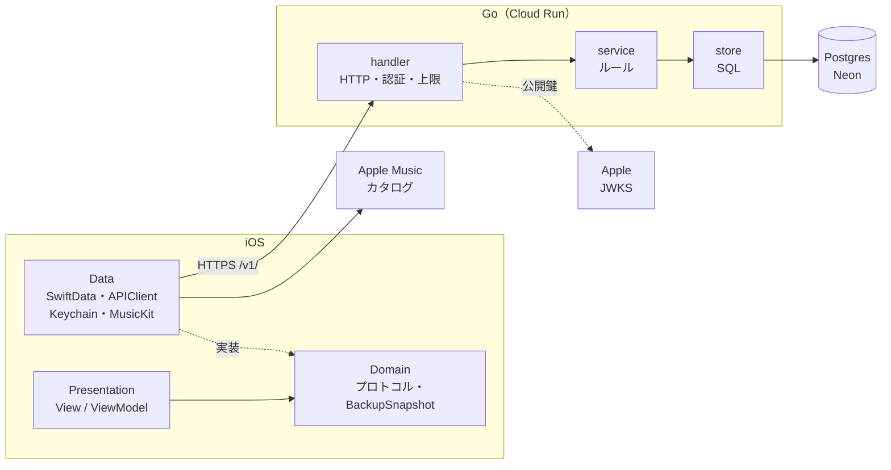
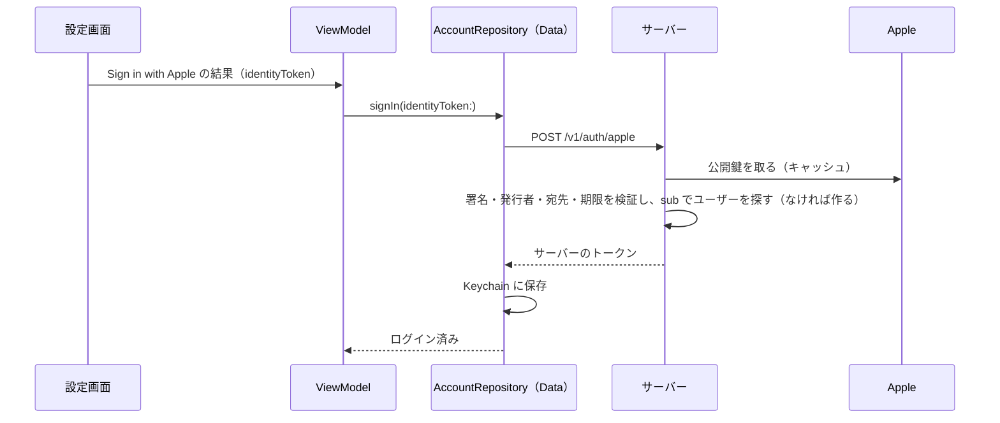

# サーバーと MusicKit の設計

端末を超えて記録を残すためのサーバー（Go）と、曲名の入力を助ける MusicKit の設計。要件・構成・API・データの流れ・責任の分け方をまとめる。

この文書は全体の地図。正はタスク・仕様が GitHub Issues、判断が ADR（[0048](adr/0048-introduce-go-server.md)・[0049](adr/0049-account-and-full-backup.md)）で、最上位は[憲法](constitution.md)。Issue を 1 つ終えるたびに、作ったものに合わせてこの文書を直す。

---

## MVP の範囲

| 記号 | 中身 | MVP |
|---|---|---|
| C1 | Sign in with Apple のアカウントと、記録の全件バックアップ・空の端末への取り込み | 入れる |
| M1 | 曲名を打つと Apple Music の候補（もしかして？）を出し、選ぶと曲の ID を保存する | 入れる |
| C2 | 2 台の端末の間の同期（同期ボタン、後から書いたほうを残す） | 後 |
| C3 | 自動の同期と、同じ曲をまとめる処理 | 後 |
| M2 | 曲の ID で同じ曲を判定し、表示をカタログの曲名とアートワークにする | 後 |
| — | App Store に出す準備（Apple のトークンの取り消し・プライバシーのラベルとポリシー・本番の環境） | 後 |

MVP の間、アカウントとバックアップの機能はデバッグのビルドでだけ出す（`#if DEBUG`）。リリースのビルドと TestFlight には出さない。

## 機能要件

| 番号 | 要件 |
|---|---|
| FR-1 | 設定画面から Sign in with Apple でアカウントを作れる。ログインしているかが分かり、ログアウトできる |
| FR-2 | アカウントを消せる（確認付き）。消すと、サーバーにあるその人のデータがすぐに全部消える |
| FR-3 | 設定画面のボタンで、全部の記録をサーバーにバックアップできる。最後にバックアップした日時と、メモはバックアップされないことが分かる |
| FR-4 | サーバーにバックアップがあるときは、「サーバーの N 件を、この端末の M 件で置き換えます」と確認してから送る |
| FR-5 | ログインしたとき、端末に記録がなくサーバーにバックアップがあれば、取り込むかを聞く。記録のある端末には取り込めない。取り込むかを決めるまでは、バックアップのボタンを押せない |
| FR-6 | 記録シートで曲名を打つと Apple Music の候補が出て、選ぶと曲の ID が保存される。オフラインや許可がないときは候補を出さず、今と同じように手で入力できる |

## 非機能要件

| 番号 | 種類 | 要件 |
|---|---|---|
| NFR-1 | オフラインファースト | サーバーが止まっていても、記録・履歴・選曲はすべて動く。正は端末の SwiftData で、サーバーは本人が頼んだときだけ使う控え |
| NFR-2 | プライバシー | サーバーに置くのは Apple のユーザー ID（`sub`）と、メモを除いた記録だけ。メールアドレスも名前も受け取らない |
| NFR-3 | プライバシー | サーバーのログに記録の中身（曲名・点数・気分）を出さない |
| NFR-4 | セキュリティ | Apple のトークンは、署名・発行者・宛先（バンドル ID）・期限を検証する。サーバーが出すトークンはハッシュにして DB に保存する。通信は HTTPS だけ |
| NFR-5 | セキュリティ | 1 回のリクエストの大きさに上限を設ける（5MB） |
| NFR-6 | 費用 | 月 0 円を目指す。Cloud Run のインスタンスの数に上限を設け、予算のアラートを入れる |
| NFR-7 | 互換性 | API のパスに `/v1/` を付ける。バックアップに `schemaVersion` を持たせ、アプリのモデルが変わっても古いバックアップを読めるようにする |
| NFR-8 | 性能 | 記録 1000 件のバックアップと取り込みが数秒で終わる。インスタンスが止まっていた後の 1〜2 秒の遅れは許す |
| NFR-9 | 保守性 | Go は標準ライブラリを中心にし、handler・service をテストで確かめられるようにする。iOS 側は今と同じく、プロトコルでモックに差し替えられる |

---

## 構成



サーバーも iOS と同じ 3 段にする。handler が View、service が ViewModel、store が Repository に近い役で、service は store をインターフェース越しに使う（テストで差し替えるため）。

### サーバーのフォルダ

```
server/
├── cmd/api/main.go     # 起動と依存の組み立て（iOS の AppDependencies と同じ役）
├── internal/
│   ├── httpapi/        # ルーティングとミドルウェア（認証・大きさの上限）
│   ├── account/        # アカウント：handler / service / store
│   ├── backup/         # バックアップ：handler / service / store
│   └── appleauth/      # Apple のトークンの検証（公開鍵をキャッシュする）
├── migrations/
├── Dockerfile
└── compose.yaml        # 手元の Postgres
```

Go は標準の `net/http`（1.22 以降のルーティング）と `pgx` を使い、フレームワークは使わない（[ADR 0048](adr/0048-introduce-go-server.md)）。

### iOS に足すもの

| 層 | 足すもの |
|---|---|
| Domain | `AccountRepositoryProtocol`・`BackupRepositoryProtocol`・`MusicCatalogRepositoryProtocol`、`BackupSnapshot`（送る中身の値型）、エラーの型 |
| Data | `APIClient`（HTTP）、Keychain にトークンを置く処理、SwiftData と `BackupSnapshot` の変換、MusicKit の検索 |
| App | 上の Repository を `AppDependencies` で作り、`EnvironmentKey` で注入する（今の Repository と同じ形） |
| Presentation | 設定画面のアカウントとバックアップの欄（`#if DEBUG`）、記録シートの「もしかして？」 |

## 環境

| 環境 | サーバー | DB | 使う端末 | データ |
|---|---|---|---|---|
| local | 手元で `go run` | Docker の Postgres | シミュレーター（`localhost` で届く） | いつでも消してよい |
| staging | Cloud Run `karaoke-api-staging` | Neon の `staging` ブランチ | Xcode から入れた実機 | 自分の試し用。消してもよい |
| production | MVP では作らない | — | — | — |

- iOS は xcconfig の `API_BASE_URL` を Info.plist から読む。Debug のビルドは staging につなぐ。スキームの環境変数 `KARAOKE_API_BASE_URL` で local に上書きできる（`KARAOKE_SIMULATE_DATA_LOAD_FAILURE` と同じやり方）
- MVP の間は手でデプロイし、デプロイの前にマイグレーションを手で流す。手順は `server/README.md` に書く。GitHub Actions は MVP の後
- DB の URL などの秘密の値はリポジトリに入れず、Cloud Run の環境変数（Secret Manager）に置く

## DB

| テーブル | 列 | メモ |
|---|---|---|
| `users` | `id`, `apple_sub`（一意）, `created_at` | Apple の `sub` だけを持つ |
| `auth_tokens` | `token_hash`, `user_id`, `expires_at`, `created_at` | トークンはハッシュだけを持つ。ユーザーを消すと一緒に消える |
| `backups` | `user_id`（1 人 1 行）, `schema_version`, `payload`（jsonb）, `track_count`, `session_count`, `updated_at` | サーバーは `payload` の中身を読まない。ユーザーを消すと一緒に消える |

## API

| メソッド | パス | 中身 | 認証 |
|---|---|---|---|
| GET | `/health` | 生きているかの確認 | なし |
| POST | `/v1/auth/apple` | Apple のトークンを受け取り、サーバーのトークン（期限 90 日）を返す。ユーザーがいなければ作る | なし |
| DELETE | `/v1/auth/session` | ログアウト（今のトークンを消す） | 要る |
| GET | `/v1/me` | 自分の情報 | 要る |
| DELETE | `/v1/me` | アカウントとデータを全部消す | 要る |
| GET | `/v1/backup/summary` | バックアップの件数と日時。なければ 404 | 要る |
| PUT | `/v1/backup` | バックアップを丸ごと置き換える | 要る |
| GET | `/v1/backup` | バックアップを読む | 要る |

### バックアップの中身（`BackupSnapshot`）

| | 持つもの | 持たないもの |
|---|---|---|
| 全体 | `schemaVersion` | |
| 曲 | `id`, `userEnteredName`, `spotifyTrackId`, `appleMusicSongId`（M1 から）, `singCount`, `createdAt`, `updatedAt` | Apple Music の曲名・アーティスト名・アートワーク |
| 記録 | `id`, `trackId`, `intent`, `performedAt`, `score`, `recordedSource`, `recordedWantAgain`, `recordedIsCompleted` | **メモ** |

保存する値（`recorded…`）は空のまま送り、読むときの解釈（ADR 0034）はアプリに任せる。

---

## データの流れ

### ログイン



### バックアップ

1. ボタン → ViewModel → `BackupRepository.fetchRemoteSummary()`
2. サーバーにバックアップがあれば、ViewModel が「N 件 → M 件」の確認を出す
3. `uploadAll()`：SwiftData から全件を `BackupSnapshot` に詰め（メモは入れない）、JSON にして `PUT /v1/backup`
4. サーバーは大きさと `schemaVersion` を確かめ、1 つのトランザクションで置き換えて、日時を返す

### 取り込み

1. ログインした後、端末に記録がなく、`fetchRemoteSummary()` でバックアップがあると分かったら、取り込むかを聞く
2. `restoreAll()`：`GET /v1/backup` → `schemaVersion` を確かめる → SwiftData に全部入れて 1 回だけ保存する（途中で失敗したら何も残さない）。UUID は元のまま使う
3. `historyReloadTick` で画面を読み直す

### もしかして？

1. 曲名を打つ → ViewModel が 0.3 秒待ち、前の検索を取り消す
2. `MusicCatalogRepository.search(term:)` → MusicKit のカタログ検索
3. 候補（曲名・アーティスト名）はメモリにだけ持つ
4. 候補を選ぶと、`Track` に `appleMusicSongId` を入れて保存する。曲名の扱いは、MusicKit が使えるか確かめる Issue の ADR で決める

---

## 責任の分け方

| 層 | 受け持つこと | しないこと |
|---|---|---|
| View | 描画・Sign in with Apple のボタン・確認のダイアログ | 通信・保存 |
| ViewModel | 画面の状態・いつ確認を出すか・検索を待つ時間と取り消し | HTTP や SwiftData の型を知ること |
| Domain | プロトコル・`BackupSnapshot`・エラーの型 | 外部の仕組みを読み込むこと（`@Model` を除く） |
| Data | SwiftData と `BackupSnapshot` の変換・HTTP・Keychain・MusicKit。「空の端末にだけ取り込む」はここで守る（どこから呼ばれても記録を消さないため） | 画面の都合を持つこと |
| サーバーの handler | 入出力・認証・大きさの上限 | ルールを決めること |
| サーバーの service | アカウントを作る・消す、バックアップを置き換えるルール | SQL を書くこと |
| サーバーの store | SQL | ルールを持つこと |
| サーバー全体 | 保存と認証 | 記録の中身を読むこと・集計すること・Apple Music の曲データを持つこと |

---

## Issue の進み具合

| 順 | Issue | 要件 | 状態 |
|---|---|---|---|
| 0 | サーバーと MusicKit の設計を決め、文書にする | — | 進行中 |
| 1 | サーバーの土台を作り、staging にデプロイする | NFR-6・NFR-9 | 未着手 |
| 2 | Sign in with Apple でアカウントを作り、消せる | FR-1・FR-2・NFR-2〜4 | 未着手 |
| 3 | 記録をサーバーにバックアップする | FR-3・FR-4・NFR-5・NFR-7・NFR-8 | 未着手 |
| 4 | 別の端末で記録を取り込む | FR-5・NFR-7 | 未着手 |
| 5 | MusicKit が使えるか確かめ、扱い方を決める | FR-6 の前提 | 未着手 |
| 6 | 曲名を打つと「もしかして？」で Apple Music の曲を出す | FR-6 | 未着手 |

NFR-1（オフラインファースト）はすべての Issue で守る。5 と 6 はサーバーと関係がないので、いつ進めてもよい。
