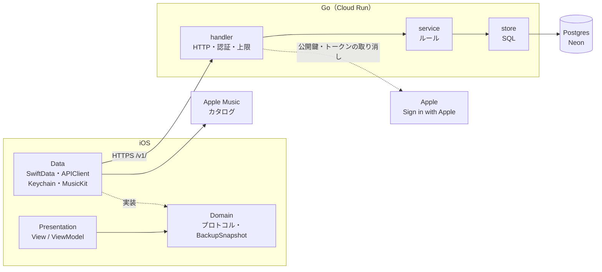
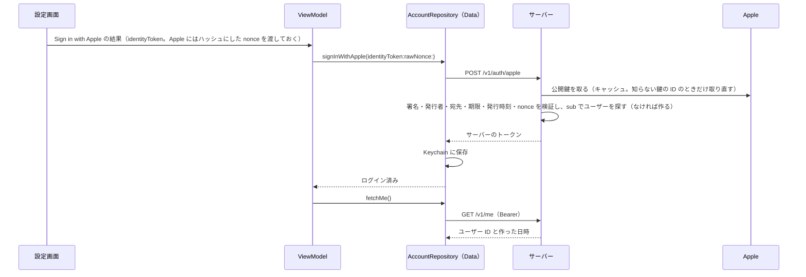

# サーバーと MusicKit の設計

端末を超えて記録を残すためのサーバー（Go）と、曲名の入力を助ける MusicKit の設計。要件・構成・API・データの流れ・責任の分け方をまとめる。

この文書は全体の地図。正はタスク・仕様が GitHub Issues、判断が ADR（[0048](adr/0048-introduce-go-server.md)・[0049](adr/0049-account-and-full-backup.md)・[0050](adr/0050-postgres-on-neon.md)・[0051](adr/0051-public-cloud-run-with-caps.md)・[0053](adr/0053-beta-testers-and-auto-backup.md)・[0054](adr/0054-sign-in-and-server-tokens.md)）で、最上位は[憲法](constitution.md)。Issue を 1 つ終えるたびに、作ったものに合わせてこの文書を直す。

---

## MVP の範囲

| 記号 | 中身 | MVP |
|---|---|---|
| C1 | Sign in with Apple のアカウントと、記録の全件バックアップ（オンにした後は自動）・空の端末への取り込み | 入れる |
| M1 | 曲名を打つと Apple Music の候補（もしかして？）を出し、選ぶと曲の ID を保存する | 入れる（C1 の後） |
| C2 | 2 台の端末の間の同期（同期ボタン、後から書いたほうを残す） | 後 |
| C3 | 2 台の間の自動の同期と、同じ曲をまとめる処理 | 後 |
| M2 | 曲の ID で同じ曲を判定し、表示をカタログの曲名とアートワークにする | 入れる（M1 の後） |
| — | App Store に出す準備（プライバシーのラベル・App Store 版のポリシー・本番の環境） | 後 |

アカウントとバックアップの機能は、Debug と Beta のビルドにだけ入れる（`#if DEBUG || BETA`）。TestFlight には Beta のビルドを上げて外部テスターに配り、App Store に出す Release のビルドには入れない。C1 ができたら、MusicKit を待たずに 11 月末に配る（[ADR 0053](adr/0053-beta-testers-and-auto-backup.md)）。

## 機能要件

| 番号 | 要件 |
|---|---|
| FR-1 | 設定画面から Sign in with Apple でアカウントを作れる。ログインしているかが分かり、ログアウトできる |
| FR-2 | アカウントを消せる（確認付き）。消すと、サーバーにあるその人のデータがすぐに全部消える。消すときにもう一度 Sign in with Apple を出し、Apple の側のトークンも取り消す |
| FR-3 | バックアップをオンにすると、アプリを閉じたときに全部の記録を自動でサーバーに送る。設定画面の「今すぐバックアップ」でも送れる。最後にバックアップした日時と、失敗したことと、メモはバックアップされないことが分かる。オン・オフの切り替え方は Issue 3 の ADR で決める |
| FR-4 | サーバーのバックアップがほかの端末から送ったものなら、自動では送らず、「サーバーの N 件を、この端末の M 件で置き換えます」と確認してから送る。自動で送ってよい条件は Issue 3 の ADR で決める |
| FR-5 | ログインしたとき、端末に記録がなくサーバーにバックアップがあれば、取り込むかを聞く。記録のある端末には取り込めない。取り込むかを決めるまでは、バックアップを送らない（自動でも、ボタンでも） |
| FR-6 | 記録シートで曲名を打つと Apple Music の候補が出て、選ぶと曲の ID が保存される。オフラインや許可がないときは候補を出さず、今と同じように手で入力できる |

## 非機能要件

| 番号 | 種類 | 要件 |
|---|---|---|
| NFR-1 | オフラインファースト | サーバーが止まっていても、記録・履歴・選曲はすべて動く。正は端末の SwiftData で、サーバーは本人がオンにしたときだけ使う控え |
| NFR-2 | プライバシー | サーバーに置くのは Apple のユーザー ID（`sub`）と、メモを除いた記録だけ。メールアドレスも名前も受け取らない。Cloud Run のリクエストのログには IP アドレスと User-Agent が残るので、保存の期間を確かめてプライバシーポリシーに書く |
| NFR-3 | プライバシー | サーバーのログとエラーの返事に、記録の中身（曲名・点数・気分）も、Apple のトークン・サーバーのトークン・`Authorization` ヘッダーも出さない |
| NFR-4 | セキュリティ | Apple のトークンは、署名（`RS256` だけを受け付ける）・発行者・宛先（バンドル ID だけ。ほかの宛先が混ざっていたら拒否）・期限・発行時刻と、iOS が作った nonce が一致するかを、golang-jwt と keyfunc で検証する。確かめる項目は、Apple の「Verifying a user」の手順と、OpenID Connect Core 1.0 の 3.1.3.7（ID Token Validation）に沿う。サーバーが出すトークンは `crypto/rand` で作ってハッシュにして DB に保存し、iOS は Keychain に `AfterFirstUnlockThisDeviceOnly` で置く（[ADR 0054](adr/0054-sign-in-and-server-tokens.md)）。通信は HTTPS だけで、DB とも TLS（`sslmode=require` 以上）でつなぐ |
| NFR-5 | セキュリティ | 1 回のリクエストの大きさに上限を設ける（5MB） |
| NFR-6 | 費用 | 月 0 円を目指す。Cloud Run のインスタンスの数の上限を 1 にし、予算のアラート（月 500 円）と Cloud Run の支出の上限（月 300 円）を入れる（[ADR 0051](adr/0051-public-cloud-run-with-caps.md)） |
| NFR-7 | 互換性 | API のパスに `/v1/` を付ける。バックアップに `schemaVersion` を持たせ、アプリのモデルが変わっても古いバックアップを読めるようにする |
| NFR-8 | 性能 | 記録 1000 件のバックアップと取り込みが数秒で終わる。インスタンスが止まっていた後の 1〜2 秒の遅れは許す |
| NFR-9 | 保守性 | Go は標準ライブラリを中心にし、handler・service をテストで確かめられるようにする。iOS 側は今と同じく、プロトコルでモックに差し替えられる |
| NFR-10 | 可用性 | サーバーは止まってもよい（NFR-1 から）。使わないと止まる無料枠と、起きるまでの数秒の待ちを受け入れる。DB は標準の Postgres だけを使い、つなぎ先を `DATABASE_URL` で渡して、URL を替えるだけで移れるようにする |

---

## 構成



サーバーも iOS と同じ 3 段にする。handler が View、service が ViewModel、store が Repository に近い役で、service は store をインターフェース越しに使う（テストで差し替えるため）。

### サーバーのフォルダ

```
server/
├── cmd/api/main.go     # 起動と依存の組み立て（iOS の AppDependencies と同じ役）
├── internal/
│   ├── httpapi/        # ルーティングとミドルウェア（認証・大きさの上限）
│   ├── account/        # アカウント：handler / service / store
│   ├── backup/         # バックアップ：handler / service / store
│   └── appleauth/      # Apple のトークンの検証（公開鍵をキャッシュする）と取り消し
├── migrations/
├── Dockerfile
└── compose.yaml        # 手元の Postgres
```

Go は標準の `net/http`（1.22 以降のルーティング）と `pgx` を使い、フレームワークは使わない（[ADR 0048](adr/0048-introduce-go-server.md)）。

### iOS に足すもの

| 層 | 足すもの |
|---|---|
| Domain | `AccountRepositoryProtocol`・`BackupRepositoryProtocol`・`MusicCatalogRepositoryProtocol`、`BackupSnapshot`（送る中身の値型）、エラーの型 |
| Data | `APIClient`（HTTP）、Keychain にトークンを置く処理、SwiftData と `BackupSnapshot` の変換、MusicKit の検索 |
| App | 上の Repository を `AppDependencies` で作り、`EnvironmentKey` で注入する（今の Repository と同じ形） |
| Presentation | 設定画面のアカウントとバックアップの欄（`#if DEBUG \|\| BETA`）、記録シートの「もしかして？」 |

## 環境

| 環境 | サーバー | DB | 使う端末 | データ |
|---|---|---|---|---|
| local | 手元で `go run` か Docker のイメージ | Docker の Postgres（`127.0.0.1` でだけ待ち受ける） | シミュレーター（`localhost` で届く） | いつでも消してよい |
| staging | Cloud Run `karaoke-api-staging`（東京 `asia-northeast1`） | Neon の `staging` ブランチ（シンガポール。Neon に東京はない、ADR 0050） | Xcode から入れた実機と、TestFlight の Beta のビルド | 自分とテスターの試し用。消すときはテスターに先に伝える |
| production | MVP では作らない | — | — | — |

- iOS は xcconfig の `API_BASE_URL` を Info.plist から読む。Debug と Beta のビルドは staging につなぎ、Release にはつなぎ先を入れない。staging の URL はコミットしない `Karaoke_support/Config/Local.xcconfig` に書き、ないときはアカウントの機能を出さない（書き方は `Local.xcconfig.example`、ADR 0055）。スキームの環境変数 `KARAOKE_API_BASE_URL` で local に上書きできる（`KARAOKE_SIMULATE_DATA_LOAD_FAILURE` と同じやり方）
- MVP の間は手でデプロイし、デプロイの前にマイグレーションを手で流す。イメージは手元で作って Artifact Registry に送る。手順は [server/README.md](../server/README.md)。GitHub Actions は MVP の後
- DB の URL などの秘密の値はリポジトリに入れず、Secret Manager に置いて Cloud Run の環境変数として渡す
- Cloud Run は誰でも呼べるようにし、専用のサービスアカウントで動かす。このアカウントは DB の URL を読む権限だけを持つ（[ADR 0051](adr/0051-public-cloud-run-with-caps.md)）
- `/health` は毎回 DB につなぐので、叩かれ続けると Neon の無料枠を使い切って月末まで止まる。外部テスターに配る前に、DB を見ない確認と分け、IP ごとのレート制限を入れる（ADR 0051・0053）

## DB

| テーブル | 列 | メモ |
|---|---|---|
| `users` | `id`, `apple_user_id`（一意）, `created_at` | Apple の `sub` だけを `apple_user_id` として持つ（iOS の `ASAuthorizationAppleIDCredential.user` と同じ値） |
| `auth_tokens` | `token_hash`, `user_id`, `expires_at`, `created_at` | トークンはハッシュだけを持つ。ユーザーを消すと一緒に消える。期限切れの行は、その人がサインインしたときに消す |
| `backups` | `user_id`（1 人 1 行）, `schema_version`, `payload`（jsonb）, `track_count`, `session_count`, `updated_at` | サーバーは `payload` の中身を読まない。件数は iOS が数えて一緒に送り、サーバーはそのまま保存する。ユーザーを消すと一緒に消える。送った端末を見分ける列は Issue 3 の ADR で決める（FR-4） |

## API

| メソッド | パス | 中身 | 認証 |
|---|---|---|---|
| GET | `/health` | 生きているかの確認 | なし |
| POST | `/v1/auth/apple` | Apple のトークンを受け取り、サーバーのトークン（期限 90 日）を返す。ユーザーがいなければ作る。その人の期限切れのトークンの行を消す | なし |
| DELETE | `/v1/auth/session` | ログアウト（今のトークンの行だけを消し、204 を返す。ほかの端末のトークンは残す） | 要る |
| GET | `/v1/me` | 自分の情報（サーバーのユーザー ID と作った日時だけ。Apple のユーザー ID は返さない） | 要る |
| DELETE | `/v1/me` | Apple の identity token・nonce・認可コードを受け取る。Apple ID が本人のものかを確かめ、Apple のトークンを取り消せたときだけ、アカウントとデータを全部消して 204 を返す（[ADR 0057](adr/0057-delete-account-and-revoke-apple-token.md)） | 要る |
| GET | `/v1/backup/summary` | バックアップの件数と日時。なければ 404 | 要る |
| PUT | `/v1/backup` | バックアップを丸ごと置き換える | 要る |
| GET | `/v1/backup` | バックアップを読む | 要る |

失敗したときは、トークンが偽物・期限切れなど利用者の側の失敗は 401、Apple や DB に届かないなどサーバーの側の失敗は 5xx を返す。返事の本文は `{"error": "..."}` の形にし、詳しい理由はログにだけ出す（ADR 0054）。

Apple の公開鍵は keyfunc がキャッシュし、Apple に届かなくても手元の鍵で確かめられるトークンは確かめる。鍵を探せず、しかも手元に鍵が 1 つもない（起動のときに Apple に届かなかった）ときだけ 5xx にする。手元に鍵はあるが、Apple が鍵を替えた直後に Apple に届かないときは 401 のまま残る（[ADR 0056](adr/0056-apple-keys-unavailable-returns-5xx.md)）。

### バックアップの中身（`BackupSnapshot`）

| | 持つもの | 持たないもの |
|---|---|---|
| 全体 | `schemaVersion` | |
| 曲 | `id`, `userEnteredName`, `appleMusicSongId`（M1 から）, `createdAt`, `updatedAt` | Apple Music の曲名・アーティスト名・アートワーク、`singCount`（取り込むときに記録の件数から数え直す）、`spotifyTrackId`（今は常に空） |
| 記録 | `id`, `trackId`, `intent`, `performedAt`, `score`, `recordedSource`, `recordedWantAgain`, `recordedIsCompleted` | **メモ** |

保存する値（`recorded…`）は空のまま送り、読むときの解釈（ADR 0034）はアプリに任せる。

---

## データの流れ

### ログイン



### ログアウト

1. 設定のアカウントの欄で「ログアウト」（確認は出さない）→ `AccountRepository.signOut()`
2. Keychain にトークンがあれば、`DELETE /v1/auth/session`（Bearer）。サーバーはそのトークンの行だけを消し、204 を返す
3. サーバーが失敗しても届かなくても、Keychain のトークンは消す。消せなかったときだけ失敗を出す。サーバーに残った行は、期限が来れば使えなくなる
4. `GET /v1/me` が 401 を返したとき（期限切れ・ほかで消された）も、Keychain のトークンを消し、サインインしていない状態に戻す。届かないときや 5xx では消さない

### バックアップ

1. アプリを閉じたとき（オンのとき）か「今すぐバックアップ」のボタン → `BackupRepository.fetchRemoteSummary()`
2. サーバーのバックアップがほかの端末から送ったものなら、自動では送らず、ViewModel が「N 件 → M 件」の確認を出す
3. `uploadAll()`：SwiftData から全件を `BackupSnapshot` に詰め（メモは入れない）、曲と記録の件数と一緒に JSON にして `PUT /v1/backup`
4. サーバーは大きさと `schemaVersion` を確かめ、1 つのトランザクションで置き換えて、日時を返す

### 取り込み

1. ログインした後、端末に記録がなく、`fetchRemoteSummary()` でバックアップがあると分かったら、取り込むかを聞く
2. `restoreAll()`：`GET /v1/backup` → `schemaVersion` を確かめる → 値を確かめる（点数は 0〜100、曲名は空でない、気分は知っている値）→ SwiftData に全部入れて 1 回だけ保存する（途中で失敗したら何も残さない）。UUID は元のまま使い、`singCount` は記録の件数から数える。`Track` と `SingingSession` の `init` は範囲外の値で止まる（`precondition`）ので、値はモデルを作る前に確かめ、1 件でもだめなら何も取り込まない
3. `historyReloadTick` で画面を読み直す

### もしかして？

1. 曲名を打つ → ViewModel が 0.3 秒待ち、前の検索を取り消す
2. `MusicCatalogRepository.search(term:)` → MusicKit のカタログ検索
3. 候補（曲名・アーティスト名）はメモリにだけ持つ
4. 候補を選ぶと、`Track` に `appleMusicSongId` を入れて保存する。曲名の扱いは、MusicKit が使えるか確かめる Issue の ADR で決める

---

## 責任の分け方

| 層 | 受け持つこと | しないこと |
|---|---|---|
| View | 描画・Sign in with Apple のボタン・確認のダイアログ | 通信・保存 |
| ViewModel | 画面の状態・いつ確認を出すか・検索を待つ時間と取り消し | HTTP や SwiftData の型を知ること |
| Domain | プロトコル・`BackupSnapshot`・エラーの型 | 外部の仕組みを読み込むこと（`@Model` を除く） |
| Data | SwiftData と `BackupSnapshot` の変換・HTTP・Keychain・MusicKit。「空の端末にだけ取り込む」と「ほかの端末のバックアップを自動で上書きしない」はここで守る（どこから呼ばれても記録を消さないため） | 画面の都合を持つこと |
| サーバーの handler | 入出力・認証・大きさの上限 | ルールを決めること |
| サーバーの service | アカウントを作る・消す、バックアップを置き換えるルール | SQL を書くこと |
| サーバーの store | SQL | ルールを持つこと |
| サーバー全体 | 保存と認証 | 記録の中身を読むこと・集計すること・Apple Music の曲データを持つこと |

---

## Issue の進み具合

| 順 | Issue | 要件 | 状態 |
|---|---|---|---|
| 0 | サーバーと MusicKit の設計を決め、文書にする（#144） | — | 済み |
| 1 | サーバーの土台を作り、staging にデプロイする（#146） | NFR-6・NFR-9・NFR-10 | 済み |
| 2-1 | サインインとサーバーのトークンの設計を決める（#151） | NFR-4 | 済み |
| 2-2 | Sign in with Apple でサインインできるようにする（#152） | FR-1・NFR-2〜4 | 済み |
| 2-3 | ログアウトと、失敗したときの備えを作る（#153） | FR-1・NFR-2〜4 | 済み |
| 2-4 | アカウントを消せるようにする（Apple のトークンも取り消す） | FR-2 | 未着手 |
| 3 | 記録をサーバーにバックアップする（オンにした後は自動で） | FR-3・FR-4・NFR-5・NFR-7・NFR-8 | 未着手 |
| 4 | 別の端末で記録を取り込む | FR-5・NFR-7 | 未着手 |
| 5 | Beta のビルドを作り、外部テスターに配る（レート制限・`/health` の分割・プライバシーポリシー） | NFR-2・NFR-6 | 未着手 |
| 6 | MusicKit が使えるか確かめ、扱い方を決める | FR-6 の前提 | 未着手 |
| 7 | 曲名を打つと「もしかして？」で Apple Music の曲を出す | FR-6 | 未着手 |
| 8 | 曲の ID で同じ曲を判定し、カタログの曲名で表示する（M2） | — | 未着手 |

5 までが 11 月末の目標。6〜8 は C1 の後に進め、間に合わなくても 5 は止めない（ADR 0053）。NFR-1（オフラインファースト）はすべての Issue で守る。
