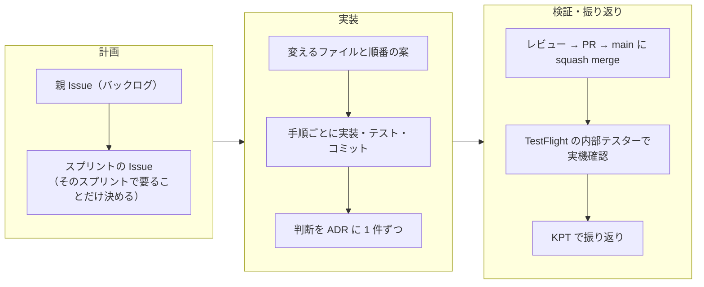

# 開発プロセス

## V1（MVP）の定義

V1 は **「コア体験が成立するかを検証する最小構成」** として定義した。具体的には **曲選択 → 歌唱 → 記録 → 振り返り** のフローが一連で動作することを完了条件とする。

| 判断基準 | V1（今回のスコープ） | V2（次期スコープ） |
|----------|---------------------|-----------------|
| コア体験に必須か | 必須 — 手動曲入力・Intent・スコア・履歴・インサイト | 付加価値 — Spotify 連携・検索 API・オンボーディング |
| 体験が完結するか | ローカルだけで完結（オフラインでも動作） | 外部 API が前提の機能 |
| 本質か付加価値か | 記録と振り返りの本質 | 体験の質を高める拡張 |

**V1 の完了条件・チェックリスト**: [`archive/v1_issues.md`](archive/v1_issues.md)（末尾の V1 完了判定チェックリスト。アーカイブ）を参照。

---

## Issue → 実装 → 検証 の流れ

仕様とタスクは GitHub Issues、設計の判断は ADR に置き、機能は「常に動く単位」で縦に切って進める（[ADR 0010](adr/0010-issues-and-adr-as-source-of-truth.md)）。

### 各ステップの詳細

1. **親 Issue にバックログを置く** — 例：選曲MVP（#114）。検証したい順にスプリントを並べ、終わるたびに見直す
2. **1 スプリント = 1 Issue = 1 ブランチ** — main にマージされたものが、いつも実機で使える状態を保つ。スプリントの始めには、そのスプリントで要ることだけ決める
3. **実装の前に案を出す** — 変えるファイルと進める順番を AI が出し、人が決める。手順ごとに実装・テストし、人がコミットする
4. **判断は ADR に残す** — 何を比べ、どんなトレードオフがあり、なぜ選んだか、いつ見直すかを 1 件 1 ファイルで書く（[adr/](adr/README.md)）。承認した本文は書き換えず、変えるときは新しい番号で置き換える
5. **確かめる** — ユニットテスト（Swift Testing、SwiftData は in-memory の `ModelContainer`）、シミュレーター、TestFlight の内部テスターでの実機確認。モデルに項目を足したときは、前のビルドで作ったデータを新しいビルドで開く
6. **レビューしてマージ** — プロジェクト用のレビュー（下記）を通し、PR で main に squash merge する
7. **振り返る** — スプリントごとに KPT で振り返り、次のスプリントの進め方に反映する

---

## AI の使い方

### 道具

| 区分 | 使用ツール |
|------|------------|
| OS / 実行 | macOS、**Xcode**（ビルド・シミュレーター・実機・デバッグ） |
| AI | **Claude Code**（デスクトップアプリ）。調査・実装案・実装・テスト・シミュレーターでの確認・レビュー・文書を任せる。決めること、実機での確認、コミットとマージは人が行う |
| AI 向けの文書 | [`CLAUDE.md`](../CLAUDE.md)（毎回読み込まれる入口。ビルドの方法、アーキテクチャ、コーディングと Git の決まり、守る制約）と、最上位のルールの[憲法](constitution.md) |
| レビュー | `.claude/skills/karaoke-review/`（プロジェクト用のレビューのスキル） |

### 決まりを 1 か所にまとめる

AI が毎回読み込む文書は `CLAUDE.md` の 1 本にしている。同じ決まりが複数の文書に少しずつ違う言い方で書いてあると、どれが正か分からなくなり、読み込む量も増えるため。理由や経緯は ADR に置き、`CLAUDE.md` からは番号で参照する。

### プロジェクト用のレビュー

`karaoke-review` は、このプロジェクトで「壊れても気づきにくい」6 点だけを見る（Spotify のメタデータの永続化、編集の握り潰し、古い非同期結果の上書き、二重保存、Repository を経由しない DB への書き込み、Presentation への具体的な Repository の型の漏れ）。コンパイラやテストが見つけるもの、一般的な書き方の指摘は外している。報告するのは「このまま出したらユーザーの画面で何が起きるか」を 1 文で言えるものだけにして、指摘の数より信頼度を優先している。

### AI の具体的な効果

- **出す前に、古いデータで落ちることが分かった** — 記録に入口（提案からか）を足したとき、テストは全部通っていた。前のビルドで作ったデータを新しいモデルで開いて確かめると、足した列が空のままで読むと落ちることが分かり、空を許す形に変えた（[ADR 0034](adr/0034-record-source-as-optional-enum.md)）
- **言われたことを、確かめてから決めた** — 「`@Entry` は初期値を読むたびに作り直す」ことをマクロの展開と小さなプログラムで確かめてから、環境に置く値の書き方の基準を決めた（[ADR 0031](adr/0031-environment-values-by-default-identity.md)）
- **最上位のルールを守らせた** — 憲法に「Spotify のメタデータは永続化しない」「`spotifyTrackId` だけ持ってよい」と書いたことで、AI が作るモデルでも、ユーザーが入力した曲名と Spotify 由来のデータが区別されている（[ADR 0002](adr/0002-no-persisting-spotify-metadata.md)）

---

## V1 で実装したもの

Phase 0〜2（V1 スコープ）は全 Issue 実装済み。代表的なものを抜粋:

| Issue | 概要 | 実装の要点 | テスト |
|-------|------|-----------|--------|
| I-002 | SwiftData モデル定義 | `Track`（メタデータ非永続化・dual init）、`SingingSession`（UUID idempotency key） | — |
| I-003 | SessionRepository | 保存（冪等）・更新（Track 差し替え禁止）・削除（singCount 減算）・fetchByIntent | 4 ファイル |
| I-009/011 | 歌唱記録 + 冪等性 | RecordingSheetViewModel + exists(uuid) チェック | `I011SessionIdempotencyTests` |
| I-014/015 | History + Infinite Scroll | 値型スナップショット・loadGeneration・20 件ページング | 3 ファイル |
| I-017/018 | インテントタブ + タイムマシン | IntentTabViewModel・月次ランキング集計 | `IntentTabViewModelTests` |

全対応は [`archive/v1_issues.md`](archive/v1_issues.md)、当時の実装ログは [`archive/log/`](archive/log/)（どちらもアーカイブ）を参照。
